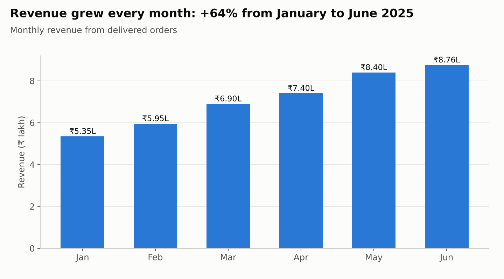
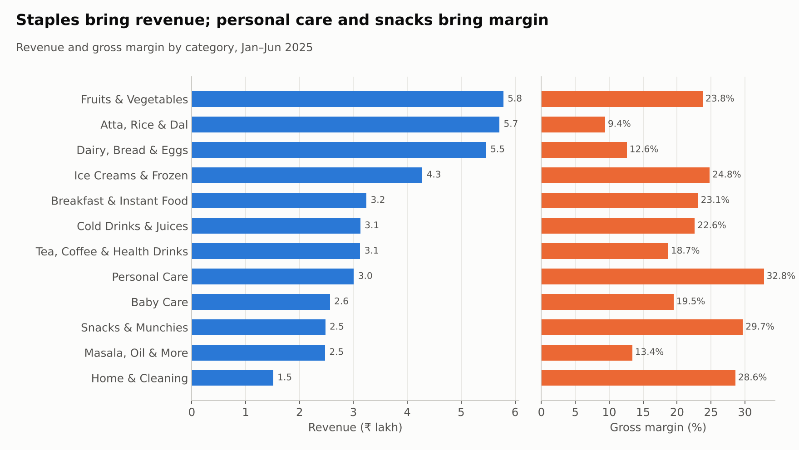

# Zepto Sales Performance Analysis (SQL)

End-to-end SQL analysis of a quick-commerce business modelled on **Zepto**: six months of orders (Jan–Jun 2025) across 22 dark stores in 6 Indian cities. The project goes from raw, messy data through cleaning and analysis to business recommendations, using **MySQL 8** only.

> **Data note:** real Zepto sales data is not public, so this project uses a **simulated dataset** generated with a Python script (written with AI assistance, see `scripts/generate_data.py`). Products, brands and MRPs are realistic Indian grocery items, and the data includes realistic business patterns and deliberate data-quality problems. All cleaning, SQL analysis and business findings are my own work.

**Full report:** [reports/findings_report.md](reports/findings_report.md)

---

## Key results

| Metric | Value |
|---|---|
| Revenue (delivered orders) | **₹42.76 lakh** |
| Gross margin | **20.3%** |
| Delivered orders | 8,990 of 9,723 placed |
| Average order value | ₹475.7 |
| Average delivery time | 12.6 min |
| Repeat customer rate | 82.9% |



**Top findings**
1. **Revenue grew 64%** from January to June, driven entirely by **more orders**. Average order value stayed flat at about ₹475.
2. **Staples bring revenue, not profit.** Atta, Rice & Dal is #2 in revenue at a 9.4% margin. Personal Care earns 32.8%.
3. **Mumbai and Delhi NCR deliver about 2 minutes slower** than other cities. Only ~17% of their orders arrive within 10 minutes.
4. **Orders peak at 8–9 AM and 7–9 PM**, and delivery slows by ~3 minutes in those hours. Weekends are 27% busier.
5. **Summer more than triples ice cream demand** (3.6×) and lifts cold drinks 2.6×.
6. **The top 20% of customers bring 54.5% of revenue.** 109 sign-ups never ordered.
7. **Deeper discounts don't increase quantity bought**, and the 21%+ discount band earns the lowest margin.



---

## Database design

Six related tables (primary and foreign keys):

```
categories ──< products ──< order_items >── orders >── customers
                                              │
                                         dark_stores
```

| Table | Rows | Description |
|---|---|---|
| `categories` | 12 | Product categories |
| `products` | 106 | Name, brand, MRP, cost price, weight |
| `dark_stores` | 22 | Store code, city, area |
| `customers` | 2,000 | Name, contact, city, signup date (2,008 before de-duplication) |
| `orders` | 9,723 | Customer, store, timestamp, payment method, status, delivery time, delivery fee |
| `order_items` | 34,423 | Products in each order: quantity, MRP, discount %, selling price (34,444 before cleaning) |

---

## Project structure

```
Zepto-SQL-Project/
├── README.md
├── sql/
│   ├── 01_zepto_sales_setup.sql      # creates the database, tables and loads the data
│   ├── 02_explore.sql                # first look: SELECT, LIMIT, DESCRIBE
│   ├── 03_basics.sql                 # WHERE, ORDER BY, DISTINCT
│   ├── 04_filtering.sql              # AND/OR, IN, BETWEEN, LIKE, IS NULL
│   ├── 05_cleaning.sql               # UPDATE, DELETE, TRIM, duplicates, ALTER TABLE
│   ├── 06_aggregation.sql            # COUNT, SUM, AVG, GROUP BY, HAVING
│   ├── 07_case_and_functions.sql     # CASE WHEN, date & text functions, COALESCE
│   ├── 08_joins.sql                  # INNER / LEFT JOIN across 3-5 tables
│   ├── 09_subqueries.sql             # subqueries in WHERE / FROM / SELECT, correlated
│   ├── 10_ctes.sql                   # WITH clauses, customer segmentation
│   ├── 11_window_functions.sql       # RANK, DENSE_RANK, ROW_NUMBER, LAG, NTILE, running totals
│   └── 12_views_and_report.sql       # CREATE VIEW, executive summary
├── data/csv/                         # the same raw data as CSV files
├── reports/
│   ├── findings_report.md            # full findings and recommendations
│   └── charts/                       # 5 charts used in the report
└── scripts/
    ├── generate_data.py              # creates the simulated dataset
    └── make_charts.py                # builds the report charts from the database
```

---

## SQL skills demonstrated

| Area | Examples in this project |
|---|---|
| Data cleaning | Standardising 16 city spellings to 6 with `TRIM` + `UPDATE`; removing duplicates with `SELECT DISTINCT` and a self-join `DELETE`; handling `NULL`s |
| Aggregation | KPIs, category and city performance with `GROUP BY` / `HAVING` |
| Conditional logic | Price bands, delivery-speed bands, customer segments with `CASE WHEN` |
| Joins | Up to 5-table joins; `LEFT JOIN ... IS NULL` to find customers who never ordered |
| Subqueries and CTEs | Products above their category average (correlated subquery); multi-step customer segmentation |
| Window functions | Top 3 products per category (`RANK`), MoM growth (`LAG`), running totals, customer quintiles (`NTILE`), 7-day moving average |
| Views | `vw_sales`, `vw_monthly_kpis`, `vw_category_performance`, `vw_city_performance` |

---

## Recommendations (summary)

1. Add rider and picker capacity in **Mumbai and Delhi NCR during 8–10 AM and 7–10 PM**.
2. **Grow demand in Chennai and Pune** before opening new stores (revenue per store is 36–46% of Bengaluru's).
3. Nudge carts between **₹150 and ₹198** (7.4% of orders) to add one more item, using high-margin categories.
4. Replace blanket 20%+ discounts with targeted acquisition offers.
5. Bundle low-margin staples with high-margin products.
6. Build ice cream and cold-drink stock from March for the summer peak.
7. Start a loyalty programme for the top 20% of customers.

Details and reasoning: [findings_report.md](reports/findings_report.md#10-recommendations)

---

## How to run it

1. Install **MySQL 8** and **MySQL Workbench**
2. Open `sql/01_zepto_sales_setup.sql` and run the whole file (creates the `zepto_sales` database)
3. Run `sql/05_cleaning.sql` **once** (it changes the data)
4. Run any of the other files. Each query has a comment explaining what it answers and the result.

Business rule used throughout: **revenue = quantity × selling price, for delivered orders only.**

---

**Author:** Shanmukha Badiger · Financial Analyst · [GitHub: 24Shanmukh](https://github.com/24Shanmukh)
