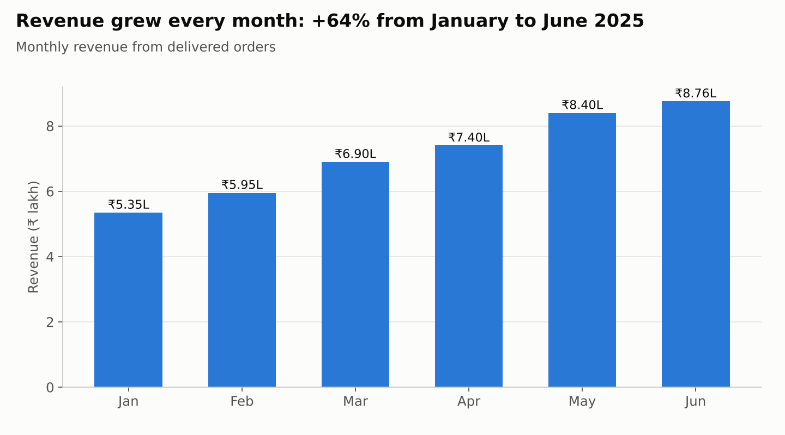
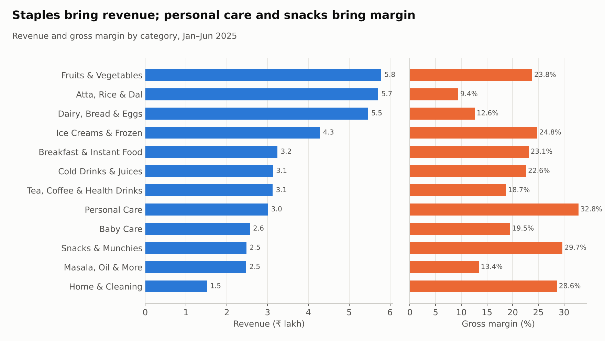
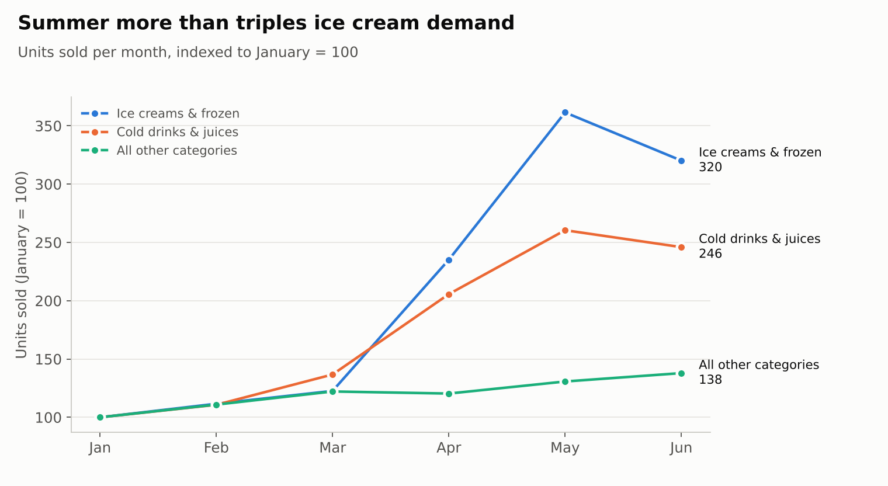
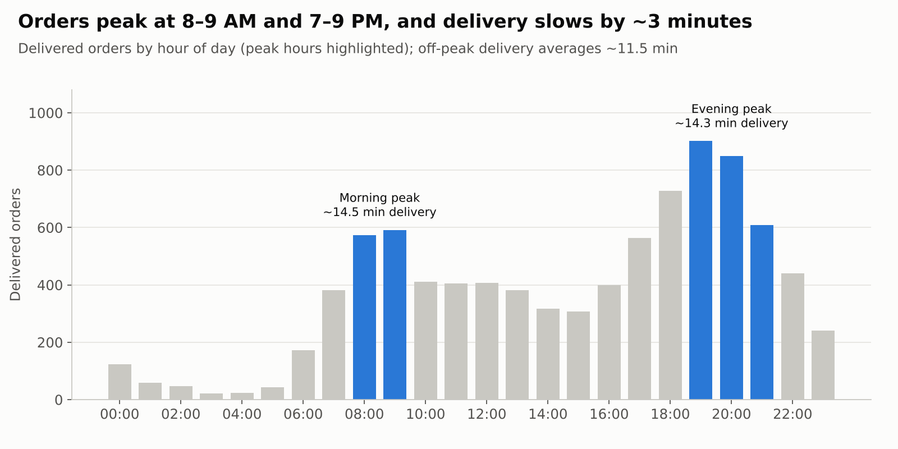
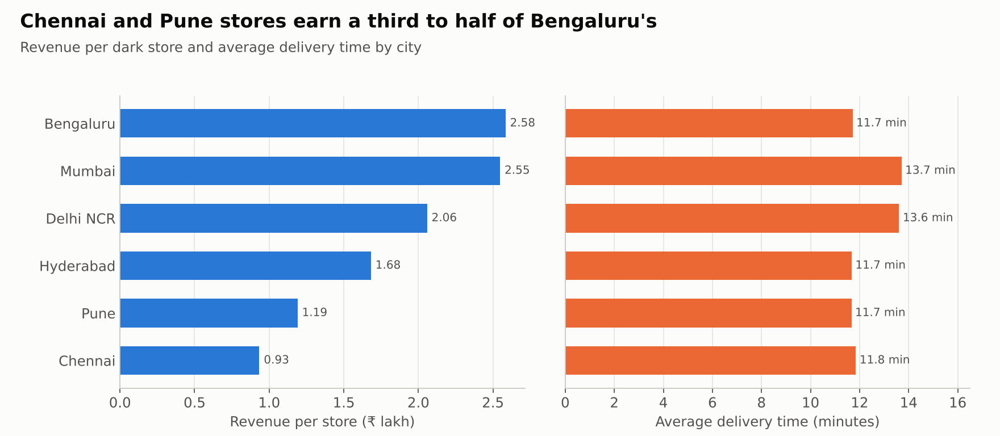

# Zepto Sales Performance Analysis: Findings Report

**Period:** January–June 2025  **Tool:** MySQL 8  **Author:** Shanmukha Badiger

> **Data note:** this analysis uses a **simulated dataset** modelled on a quick-commerce business like Zepto (real Zepto sales data is not public). Products, brands and MRPs are realistic Indian grocery items. Every number below comes from the SQL files in `/sql`.

**Definitions used throughout**
- **Revenue** = quantity × selling price, for **delivered** orders only (cancelled and returned orders earned nothing)
- **Gross profit** = quantity × (selling price − cost price)
- **Gross margin** = gross profit ÷ revenue
- **AOV (average order value)** = revenue ÷ delivered orders

---

## 1. Executive summary

| Metric | Value |
|---|---|
| Orders placed | 9,723 |
| Delivered orders | 8,990 |
| Cancelled / returned | 506 / 227 (7.5% of orders) |
| Active customers | 1,869 |
| Units sold | 45,319 |
| **Revenue** | **₹42.76 lakh** |
| **Gross profit** | **₹8.69 lakh (20.3% margin)** |
| Discounts given | ₹6.50 lakh |
| Average order value | ₹475.7 |
| Average delivery time | 12.6 minutes |
| Repeat customer rate | 82.9% |

**Five things leadership should know**
1. **Growth is strong and comes from more orders, not bigger baskets.** Revenue rose 64% from January to June, while order value stayed flat at about ₹475.
2. **The biggest revenue categories are the lowest-margin ones.** Atta, Rice & Dal is #2 in revenue but earns only a 9.4% margin. Personal Care earns 32.8%.
3. **Mumbai and Delhi NCR deliver about 2 minutes slower**, and only ~17% of their orders arrive within 10 minutes, against 34–38% in other cities.
4. **Chennai and Pune stores are under-used.** They earn ₹0.93–1.19 lakh per store against ₹2.58 lakh in Bengaluru.
5. **Revenue is concentrated in a small group of customers.** The top 20% bring 54.5% of revenue.

---

## 2. Data preparation (`05_cleaning.sql`)

The raw data had seven quality issues. Each was found with SQL and then fixed or documented:

| # | Problem | How it was found | Action |
|---|---|---|---|
| 1 | 16 spellings of 6 city names ("Bangalore", "bengaluru", "BENGALURU ", "Bombay"…) | `GROUP BY BINARY city` | `TRIM()` + `UPDATE` to standard names |
| 2 | 8 duplicate customer rows | `GROUP BY customer_id HAVING COUNT(*) > 1` | Rebuilt the table with `SELECT DISTINCT`, added a primary key |
| 3 | 3 products with no brand | `WHERE brand IS NULL` | Filled from the product name |
| 4 | 15 duplicated order lines | `GROUP BY order_id, product_id HAVING COUNT(*) > 1` | Deleted the later copy (self-join `DELETE`) |
| 5 | 6 order lines with quantity 0 or −1 | `WHERE quantity <= 0` | Deleted as invalid |
| 6 | 602 orders with no delivery time | `WHERE delivery_time_mins IS NULL` | 506 are cancelled orders, where a blank is correct. 96 delivered orders were kept, since `AVG()` ignores NULLs |
| 7 | 72 customers without email, 42 without phone | `SUM(email IS NULL)` | Documented. Not needed for sales analysis |

Result: 2,000 customers, 106 products, 9,723 orders and 34,423 valid order lines.

---

## 3. Sales trend

| Month | Delivered orders | Revenue | MoM growth | AOV |
|---|---|---|---|---|
| Jan | 1,139 | ₹5.35 L | – | ₹469.6 |
| Feb | 1,232 | ₹5.95 L | +11.3% | ₹483.3 |
| Mar | 1,444 | ₹6.90 L | +15.9% | ₹477.8 |
| Apr | 1,537 | ₹7.40 L | +7.3% | ₹481.7 |
| May | 1,805 | ₹8.40 L | +13.4% | ₹465.3 |
| Jun | 1,833 | ₹8.76 L | +4.3% | ₹477.7 |

**Insight:** revenue grew every month. Since AOV hardly moved, **all of the growth came from order volume**. The next lever is basket size (see recommendation 3).

*Queries: `10_ctes.sql` Q2, `11_window_functions.sql` Q2 (LAG) and Q3 (running total).*

---

## 4. Category performance

| Category | Revenue | Share | Gross margin | Avg discount |
|---|---|---|---|---|
| Fruits & Vegetables | ₹5.78 L | 13.5% | 23.8% | 14.3% |
| Atta, Rice & Dal | ₹5.71 L | 13.4% | **9.4%** | 11.1% |
| Dairy, Bread & Eggs | ₹5.46 L | 12.8% | 12.6% | 6.3% |
| Ice Creams & Frozen | ₹4.28 L | 10.0% | 24.8% | 10.1% |
| Breakfast & Instant Food | ₹3.24 L | 7.6% | 23.1% | 15.0% |
| Cold Drinks & Juices | ₹3.13 L | 7.3% | 22.6% | 12.0% |
| Tea, Coffee & Health Drinks | ₹3.13 L | 7.3% | 18.7% | 14.0% |
| Personal Care | ₹3.01 L | 7.0% | **32.8%** | 22.2% |
| Baby Care | ₹2.56 L | 6.0% | 19.5% | 11.8% |
| Snacks & Munchies | ₹2.48 L | 5.8% | 29.7% | 17.0% |
| Masala, Oil & More | ₹2.47 L | 5.8% | 13.4% | 12.9% |
| Home & Cleaning | ₹1.51 L | 3.5% | 28.6% | 20.1% |

**Insights**
- The **top 4 categories make up ~50% of revenue** (`11_window_functions.sql` Q4, cumulative share).
- **Revenue and profit leaders are different categories.** Staples (Atta, Rice & Dal; Dairy) drive traffic and revenue at thin margins. Personal Care, Snacks and Home & Cleaning earn 28–33% margins on small revenue.
- Dairy is bought most often (8,710 units, the highest of any category). It's the everyday reason customers open the app.

**Top products:** Mango Alphonso 6 pcs (₹2.78 L), Fortune Sona Masoori Rice 5 kg (₹1.59 L), Pampers Pants (₹1.41 L). The most-bought items by units are Nandini Toned Milk, Amul Masti Dahi and Amul Cheese Slices.
**Lowest revenue:** Green Chilli, Gillette Guard, Tata Salt, Coriander and Lay's. These are cheap add-ons that still sell 250–500 units each, so **low revenue alone isn't a reason to remove them**.

*Queries: `08_joins.sql` Q3–Q5, `11_window_functions.sql` Q1 (top 3 per category).*

---

## 5. Seasonality

**Insight:** from January to May, ice cream units grew **3.6×** and cold drinks **2.6×**, while all other categories grew 1.3× (in line with overall growth). Demand peaks in May and eases slightly in June.

*Query: `10_ctes.sql` Q5.*

---

## 6. When customers order

- **Two daily peaks:** 8–9 AM (breakfast) and 7–9 PM (dinner). **7 PM is the busiest hour** (901 delivered orders).
- During peaks, **delivery time rises from ~11.5 to ~14.5 minutes.** Store capacity is stretched exactly when demand is highest.
- **Weekends are ~27% busier**: 63.4 orders a day against 49.8 on weekdays.
- 27.7% of orders arrive within 10 minutes, 79% within 15 minutes, and 1.1% take over 20 minutes.

*Queries: `07_case_and_functions.sql` Q3, Q8, Q9.*

---

## 7. City and store performance

| City | Stores | Delivered orders | Revenue | Revenue per store | Avg delivery | Within 10 min |
|---|---|---|---|---|---|---|
| Bengaluru | 5 | 2,661 | ₹12.92 L | ₹2.58 L | 11.7 min | 36.3% |
| Mumbai | 4 | 2,158 | ₹10.19 L | ₹2.55 L | **13.7 min** | **16.5%** |
| Delhi NCR | 4 | 1,753 | ₹8.23 L | ₹2.06 L | **13.6 min** | **17.9%** |
| Hyderabad | 3 | 1,049 | ₹5.05 L | ₹1.68 L | 11.7 min | 38.0% |
| Pune | 3 | 735 | ₹3.57 L | ₹1.19 L | 11.7 min | 37.1% |
| Chennai | 3 | 634 | ₹2.80 L | ₹0.93 L | 11.8 min | 33.6% |

**Insights**
- **Best store:** ZPT-BEN-02, HSR Layout, Bengaluru (₹2.83 L). **Weakest:** all three Chennai stores (~₹0.93 L each), ranked 20–22 of 22.
- Mumbai and Delhi NCR have strong demand but **slower delivery**, which is the main quick-commerce promise.
- Chennai and Pune deliver as fast as Bengaluru but get **far fewer orders per store**. That's a demand problem, not an operations problem.

*Queries: `08_joins.sql` Q6–Q7, `11_window_functions.sql` Q5 (DENSE_RANK by city).*

---

## 8. Customers

| Segment (orders in 6 months) | Customers | Revenue share |
|---|---|---|
| One-time (1) | 319 | 3.5% |
| Occasional (2–5) | 1,076 | 38.1% |
| Regular (6–15) | 408 | 38.6% |
| Loyal (16+) | 66 | **19.8%** |

- **82.9% of buying customers ordered more than once.** On average they order 4.8 times in six months, about every 22 days.
- **Pareto effect:** the top 20% of customers bring **54.5%** of revenue. The bottom 20% bring 2.8%.
- Just **66 loyal customers (3.5% of buyers) bring ~20% of revenue.**
- **109 customers signed up but never ordered**, a ready re-activation list (`08_joins.sql` Q8, LEFT JOIN).

*Queries: `10_ctes.sql` Q3–Q4, `11_window_functions.sql` Q6 (NTILE), Q8 (LAG gap).*

---

## 9. Payments, failed orders and discounts

- **UPI dominates at 61.6% of orders.** Cards account for 20.9%, Cash on Delivery 11.1% and wallets 6.4%. Cancellation rates are similar across methods (4–6%).
- **Failed orders cost ₹3.68 lakh**: ₹2.62 L cancelled plus ₹1.06 L returned, or ~7.9% of total order value.
- **Deeper discounts don't increase quantity.** Customers buy ~1.43 units per order line whether the discount is 0% or over 20%. The 21%+ discount band also earns a lower margin (18.6%) than the 1–10% band (21.2%).
- **73.7% of orders already qualify for free delivery** (₹199+). Another **7.4% sit just below, at ₹150–198**.

*Queries: `06_aggregation.sql` Q3, `07_case_and_functions.sql` Q10, `08_joins.sql` Q11, `09_subqueries.sql` Q5.*

---

## 10. Recommendations

| # | Recommendation | Based on | Expected impact |
|---|---|---|---|
| 1 | **Add rider and picker capacity in Mumbai and Delhi NCR for 8–10 AM and 7–10 PM.** | Delivery is ~2 min slower there, and ~3 min slower at peaks everywhere | Protects the 10-minute promise where demand is highest |
| 2 | **Grow demand in Chennai and Pune before opening more stores**, with local first-order offers and re-activation of the 109 never-ordered sign-ups. | Revenue per store is 36–46% of Bengaluru's, though delivery is equally fast | Better use of existing store capacity |
| 3 | **Raise basket size with "add one more item" nudges** for carts between ₹150 and ₹198 (7.4% of orders), using high-margin snacks and personal care. | AOV is flat, and growth came only from order count | Higher AOV and margin together |
| 4 | **Shift discounts away from blanket 20%+ deals.** Use them for acquisition, not on items people already buy. | Discount depth doesn't change quantity bought, and the 21%+ band has the lowest margin | Recovers part of the ₹6.5 lakh given as discounts |
| 5 | **Pair low-margin staples with high-margin categories** (e.g. atta + ghee + snacks bundles). | Staples drive revenue at 9–13% margin; personal care and snacks earn 28–33% | Improves blended gross margin |
| 6 | **Stock up ice creams and cold drinks from March onward**, with the extra freezer stock in stores ready before April. | Summer demand rises 2.6–3.6× | Fewer stock-outs at peak season |
| 7 | **Start a loyalty programme for the top 20% of customers.** | Top 20% = 54.5% of revenue; 66 customers = ~20% | Protects the most valuable revenue |
| 8 | **Investigate cancellations** (₹2.62 lakh lost), starting with item availability at the store and delivery-time promises. | 5.2% of orders cancelled | Recovers lost revenue |

---

## 11. Limitations

- The data is **simulated**, so patterns reflect the assumptions built into the generator, not real Zepto operations.
- Cost price is a single figure per product. Real costs vary over time, and delivery, rider and store costs aren't included, so the margin shown is **product gross margin**, not net profit.
- Only six months of data, so year-on-year seasonality can't be measured.
- 96 delivered orders (1%) have no delivery time and are excluded from delivery-time averages.
